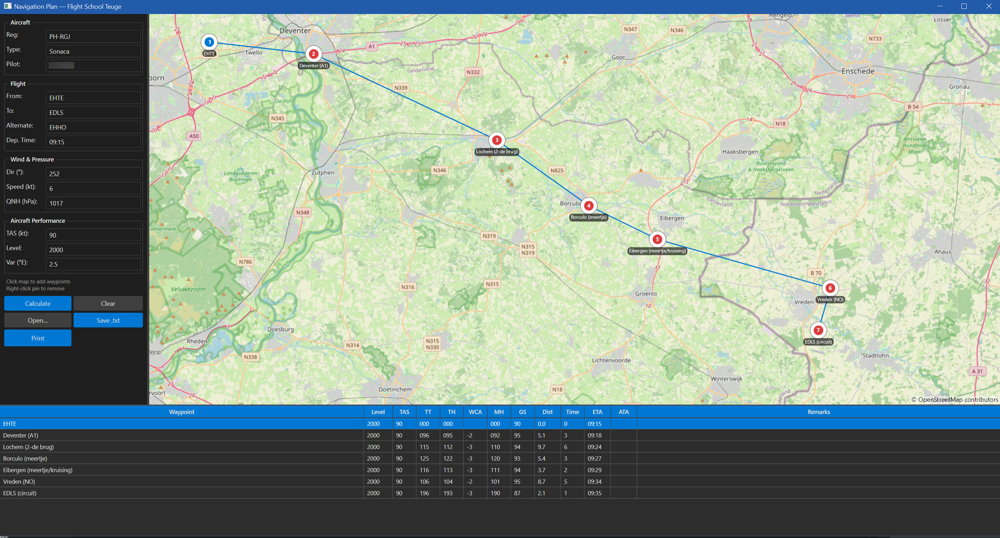

# NavigationPlan

A WPF .NET 8 desktop application for VFR flight navigation planning, built for student pilots at **Flight School Teuge** (EHTE), the Netherlands.



## Features

- **Interactive map** — OpenStreetMap street view or ESRI satellite imagery, switchable with a dropdown. Click anywhere to add waypoints; right-click a pin to remove it.
- **Configurable departure & destination airports** — type any ICAO code in the Find box, press Enter to zoom the map to it, then click "Set as Dep." or "Set as Dest." to make it the fixed departure/destination pin (blue/green, protected from accidental removal). Or use "Dep. Airport…" / "Dest. Airport…" to enter coordinates manually. Default departure: EHTE Teuge; destination has no default and must be set explicitly, so the nav plan always ends on a real airport.
- **Airport finder** — looks up any ICAO code from the built-in OurAirports database (downloaded once on first launch, ~85 000 airports worldwide).
- **Auto-calculation** — enter wind direction/speed and TAS; the app computes True Track, Wind Correction Angle, True Heading, magnetic Variation, Magnetic Heading, compass Deviation, Compass Heading, Ground Speed, Distance, Time, and ETA for every leg. Two automatic 5-minute buffer rows — "First Waypoint" after departure and "Entering Circuit" before the destination — pad the timeline for climb-out/orientation and circuit-joining.
- **Radio frequencies** — enter the frequency per waypoint directly in the nav table.
- **RT Calls** — one click generates a complete ATC radio telephony script for the flight: pre-departure at the departure airport (uses the Freq column of the first leg), en-route with Dutch Mil Info (132.350), and arrival at the destination. Ready to study before the flight.
- **Print — nav plan form** — sends an A4 landscape form to any printer or PDF driver, replicating the Flight School Teuge paper form.
- **Print — navigation chart** — optional second page with a map chart of the route (auto-zoomed to fit all waypoints), with Wind and QNH in the title. Toggle the "Print chart" checkbox before printing.
- **Save / Open** — save the completed plan as a `.txt` file and reopen it to restore all fields, waypoints, frequencies, ATA, and remarks.
- **Dark mode** — full dark theme throughout.

## Nav Plan Columns

| Column | Description |
| ------ | ----------- |
| Waypoint | Name of the fix (includes the two automatic buffer rows) |
| Freq | Radio frequency (editable) |
| Level | Cruise altitude (ft) |
| TAS | True Air Speed (kt) |
| TT | True Track (°) |
| WCA | Wind Correction Angle (°) |
| TH | True Heading (°) |
| VAR | Magnetic variation applied (default 2.5°E) |
| MH | Magnetic Heading (°) |
| DEV | Compass deviation applied (default 0°) |
| CH | Compass Heading (°) — the heading actually flown |
| GS | Ground Speed (kt) |
| Dist | Distance (NM) |
| Time | Leg time (min, rounded) |
| ETA | Estimated Time of Arrival |
| ATA | Actual Time of Arrival (fill in-flight) |
| Remarks | Free text (fill in-flight) |

## RT Calls

The **RT Calls** button generates a ready-to-study radio telephony script tailored to your flight plan:

```text
── 1.  PRE-DEPARTURE  —  EHTE  RADIO  (121.005)
  YOU:  EHTE Radio, PH-RGJ, Sonaca, at the apron,
          request departure information,
          VFR to EHHO, level 1500 ft, request QNH
  ATC:  PH-RGJ, EHTE Radio, runway [XX], QNH 1013, ...

── 2.  EN ROUTE  —  DUTCH MIL INFO  (132.350)
  YOU:  Dutch Mil Info, PH-RGJ, Sonaca,
          departed EHTE at 10:00, destination EHHO, ...
  ...position reports at each waypoint with actual ETAs...

── 3.  ARRIVAL  —  EHHO RADIO
  YOU:  EHHO Radio, PH-RGJ, Sonaca,
          [prev waypoint], inbound, 1500 ft, ...
```

The script uses your actual callsign, aircraft type, waypoints, ETAs, level, QNH, and departure airport. The departure frequency is read from the **Freq** column of the first row in the nav table. Use "Copy to Clipboard" to paste it to your kneeboard notes.

## Getting Started

### Prerequisites

- [.NET 8 SDK](https://dotnet.microsoft.com/download/dotnet/8.0)
- Windows 10 or later (WPF)

### Run

```bash
git clone https://github.com/ronaldgithub/NavigationPlan.git
cd NavigationPlan/NavigationPlan
dotnet run
```

Or open `NavigationPlan.slnx` in Visual Studio 2022+.

> **First launch** — the app downloads the OurAirports airport database (~6 MB) in the background and caches it locally. The Find box shows "Loading airport database…" while this happens; all other features work immediately.

## Usage

1. **Set departure & destination** — use the Find box to search an ICAO code and click "Set as Dep." or "Set as Dest.", or click "Dep. Airport…" / "Dest. Airport…" to enter coordinates manually. The departure defaults to EHTE; the destination has no default and must be set.
2. **Add waypoints** — click on the map to place intermediate waypoints; they're inserted between the departure and destination pins.
3. **Fill in the left panel** — aircraft details, wind direction/speed, QNH, TAS, cruise level, magnetic variation and deviation. Aircraft/performance fields are pre-filled with defaults (Reg PH-RGJ, Type Sonaca, Pilot R. de Groot, TAS 90 kt, Level 1500 ft) — edit as needed.
4. **Click Calculate** — all nav plan values are computed automatically, including the "First Waypoint" and "Entering Circuit" buffer rows.
5. **Enter frequencies** — type the radio frequency next to each waypoint in the Freq column (the departure airport frequency is used by RT Calls).
6. **RT Calls** — click to generate and review the full ATC call sequence for your route.
7. **Save** — exports the plan to a `.txt` file (Open… restores the full session including frequencies, ATA, and remarks).
8. **Print** — check "Print chart" if you want the map chart as a second page, then click Print.

## Tech Stack

- **WPF .NET 8**
- **[Mapsui.Wpf 4.1.9](https://mapsui.com)** — map control with OpenStreetMap and ESRI satellite tiles
- **[CommunityToolkit.Mvvm 8.4.0](https://learn.microsoft.com/en-us/dotnet/communitytoolkit/mvvm/)** — MVVM pattern
- **[OurAirports](https://ourairports.com/data/)** — open airport database (downloaded on first run)

## License

MIT
